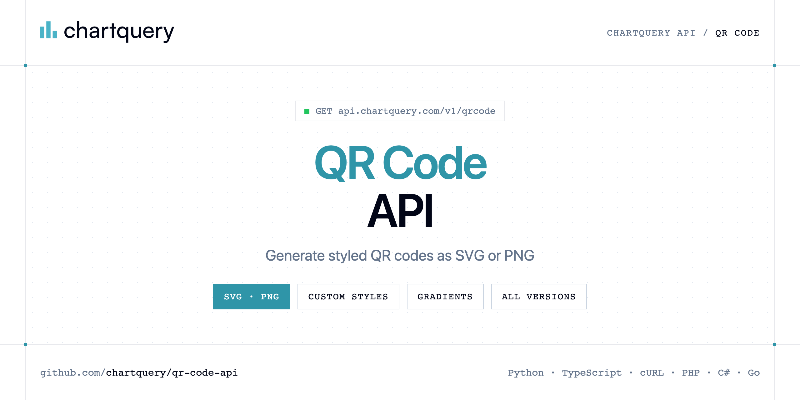

<p align="center">
  <a href="https://www.chartquery.com"></a>
</p>

# QR Code API

[](https://discord.gg/CFj3ph8aHU) [](https://app.chartquery.com/register) [](https://app.chartquery.com/openapi) [](LICENSE)

The **ChartQuery QR Code API** generates styled QR codes — dot styles, colors, gradients, custom corners and all QR versions — as SVG (default) or PNG.

- **QR Code API** — Generate a styled QR code via GET.

Use it for tickets, packaging, marketing campaigns, payments, Wi-Fi access and vCards.

| Endpoint | Request | Credits |
|---|---|---|
| [QR Code API](#qr-code-api) | `GET /v1/qrcode` | 3 |

## Table of contents

- [How it works](#how-it-works)
- [QR Code API](#qr-code-api)
- [Code examples in other languages](#code-examples-in-other-languages)
- [Use cases](#use-cases)
- [Why ChartQuery?](#why-chartquery)
- [FAQ](#faq)
- [Official SDKs](#official-sdks)
- [Related repositories](#related-repositories)
- [Support](#support)

## How it works

1. **Create a ChartQuery account** and copy your API key from the [dashboard](https://app.chartquery.com/register).
2. **Call `https://api.chartquery.com`** with the header `x-api-key: YOUR_API_KEY`.
3. **Use the result** in your app — no infrastructure to run.

```bash
export CHARTQUERY_API_KEY="your-api-key"
pip install requests        # Python
# TypeScript: Node.js 18+ (native fetch), run with `npx tsx file.ts`
```

## QR Code API

Generate a styled QR code via GET. Output: SVG (default) or PNG. Supports dot styles, gradients, custom corners and all QR versions.

`GET https://api.chartquery.com/v1/qrcode` · **3 credits per request** · [API reference](https://app.chartquery.com/openapi)

### Request parameters

| Parameter | In | Type | Required | Description |
|---|---|---|---|---|
| `data` | query | string | ✅ | Data to encode in the QR code. Examples: |
| `size` | query | number | — | Output size in pixels (width = height). Default: 200. Examples: ?size=200 (thumbnail), ?size=300 (standard), ?size=400 (large), ?size=600 (poster). For print, use the unit param with mm/cm instead. |
| `ec_level` | query | string (`L`, `M`, `Q`, `H`) | — | Error correction level. Default: M. Higher levels allow more damage/obscuring before the code becomes unreadable. |
| `dot_type` | query | string (`square`, `rounded`, `dots`, `diamond`, `classy`, `classy-rounded`) | — | Module (dot) shape. Default: `square`. Controls the visual style of each QR code module. |
| `color` | query | string | — | Module color as CSS hex. Default: #000. Examples: ?color=%236366f1 (indigo), ?color=%23dc2626 (red), ?color=%23059669 (green), ?color=%230891b2 (teal). Use %23 to URL-encode #. For gradient objects, use POST instead. |
| `shape` | query | string (`square`, `circle`) | — | Overall QR code shape. Default: square. Use circle to clip the entire QR into a circle: great for profile/avatar-style codes. Example: ?shape=circle&dot_type=dots |
| `dot_size` | query | number | — | Module size ratio between 0.1 and 1. Default: 1 (full). Values below 1 add spacing between modules for a lighter look. Example: ?dot_size=0.85 |
| `background` | query | string | — | Background color. Default: #fff. Set to transparent for no background. Example: ?background=%230f172a for dark background. Use %23 to encode #. |
| `margin` | query | number | — | Quiet zone width in modules around the QR code. Default: 4. Minimum recommended by the QR standard: 4. Example: ?margin=2 (compact) or ?margin=6 (extra padding). |
| `version` | query | number | — | QR version from 1 to 40 (determines grid size and data capacity). Leave unset for auto-selection based on data length and ec_level. Example: ?version=5 |
| `mode` | query | string (`auto`, `numeric`, `alphanumeric`, `byte`) | — | Encoding mode. Default: auto (best mode selected for the data). Use numeric for digits-only, alphanumeric for uppercase + digits, byte for arbitrary text/UTF-8. Example: ?mode=numeric |
| `mask` | query | number | — | Mask pattern from 0 to 7. Default: auto (best mask selected to minimize visual patterns). Only set manually if you need a deterministic output. Example: ?mask=3 |
| `unit` | query | string (`px`, `mm`, `in`, `cm`) | — | Measurement unit for the size param. Default: px. Use mm, in or cm with the size param for print-ready output. Example: ?size=50&unit=mm |
| `xml_declaration` | query | boolean | — | Prepend an XML declaration (<?xml version="1.0" encoding="UTF-8"?>) to the SVG output. Useful when the SVG will be used as a standalone XML file. Default: false. Example: ?xml_declaration=true |
| `aria_label` | query | string | — | Accessible label added as aria-label on the SVG element. Example: ?aria_label=QR+code+linking+to+chartquery.com |
| `title` | query | string | — | SVG <title> element shown as a browser tooltip and used by screen readers. Example: ?title=ChartQuery+Website |
| `desc` | query | string | — | SVG <desc> element for extended accessibility description. Example: ?desc=Scan+to+visit+https://chartquery.com |
| `format` | query | string (`svg`, `png`) | — | Output format. Default: svg. Use png to get a raster image. SVG is lossless and scalable; PNG is pixel-based and suitable for email, PDF or messaging. Example: ?format=png |
| `share` | query | boolean (`false`, `true`) | — | Set share=true to persist the config and receive JSON instead of an image: { id, render_url, view_url, embed_url, expires_in }. Free plan: 3-day expiry with watermark. Paid plan: 6-month expiry, no branding. |

### Python example

```python
import os

import requests

API_KEY = os.environ["CHARTQUERY_API_KEY"]
HEADERS = {"x-api-key": API_KEY}

response = requests.get(
    "https://api.chartquery.com/v1/qrcode",
    headers=HEADERS,
    params={
        "data": "https://chartquery.com",
        "format": "png",
    },
    timeout=120,
)
response.raise_for_status()

with open("qrcode.png", "wb") as f:
    f.write(response.content)
print("Saved qrcode.png", len(response.content), "bytes")
```

### TypeScript example

```typescript
import { writeFile } from "node:fs/promises";

const headers = { "x-api-key": process.env.CHARTQUERY_API_KEY!, "Content-Type": "application/json" };

const params = new URLSearchParams({
  "data": "https://chartquery.com",
  "format": "png",
});

const response = await fetch(`https://api.chartquery.com/v1/qrcode?${params}`, { headers });
if (!response.ok) throw new Error(`HTTP ${response.status}: ${await response.text()}`);

await writeFile("qrcode.png", Buffer.from(await response.arrayBuffer()));
console.log("Saved qrcode.png");
```

### Output

The response body is the generated file (saved as `qrcode.png` in every example). Error responses are JSON with an explanatory message.

## Code examples in other languages

Ready-to-run examples live in [`examples/`](examples); each reads your key from `CHARTQUERY_API_KEY`.

| Language | `qrcode` |
|---|---|
| cURL (Bash) | [qrcode.sh](examples/curl/qrcode.sh) |
| PHP | [qrcode.php](examples/php/qrcode.php) |
| C# | [Qrcode.cs](examples/csharp/Qrcode.cs) |
| Go | [qrcode.go](examples/go/qrcode.go) |
| Java | [QrcodeExample.java](examples/java/QrcodeExample.java) |
| Ruby | [qrcode.rb](examples/ruby/qrcode.rb) |
| Node.js | [qrcode.mjs](examples/nodejs/qrcode.mjs) |

## Use cases

- **Marketing** — Branded QR codes for print and packaging.
- **Tickets & events** — Generate unique QR codes per attendee.
- **Wi-Fi & contacts** — Encode Wi-Fi credentials, vCards, emails or SMS.

## Why ChartQuery?

- **Images in one request** — the response body is the PNG/SVG/PDF, ready for emails, PDFs, dashboards, Slack or `` tags.
- **Charts, diagrams, QR codes, barcodes, labels** — Chart.js configs, 28 diagram languages (Mermaid, Graphviz, PlantUML, D2…), 25+ barcode formats.
- **AI generation** — describe a chart or diagram in plain English and get the rendered image.
- **No rendering infrastructure** — no headless browser, fonts or libraries to maintain.
- **Copy-paste examples** — Python and TypeScript in each README, 7 more languages in `examples/`.

## FAQ

### How do I authenticate?

Create an account on [ChartQuery](https://app.chartquery.com/register), copy your API key and send it in the `x-api-key` header of every request to `https://api.chartquery.com`.

### How much does a request cost?

Credits per call: `/v1/qrcode` **3**. See [ChartQuery pricing](https://www.chartquery.com/pricing).

### What does the API return?

The response body is the file itself (image or document). Save it directly to disk or stream it to your storage — every example in this repository writes the file locally.

### Which languages are supported?

Any language that can make an HTTP request. This README shows Python and TypeScript; the [`examples/`](examples) folder contains cURL, PHP, C#, Go, Java, Ruby and Node.js.

## Official SDKs

Use ChartQuery from your own language with a typed client:

| SDK | Package | Install |
| --- | --- | --- |
| Node.js | [`@chartquery/sdk`](https://www.npmjs.com/package/@chartquery/sdk) | `npm install @chartquery/sdk` |
| Python | [`chartquery`](https://pypi.org/project/chartquery/) | `pip install chartquery` |
| Go | [`chartquery-go`](https://pkg.go.dev/github.com/chartquery/chartquery-go) | `go get github.com/chartquery/chartquery-go` |
| .NET | [`ChartQuery`](https://www.nuget.org/packages/ChartQuery) | `dotnet add package ChartQuery` |
| Ruby | [`chartquery`](https://rubygems.org/gems/chartquery) | `gem install chartquery` |
| PHP | [`chartquery/sdk`](https://packagist.org/packages/chartquery/sdk) | `composer require chartquery/sdk` |
| Java | [`chartquery-java`](https://github.com/chartquery/chartquery-java) | build from source, see its README |
| CLI | [`@chartquery/cli`](https://www.npmjs.com/package/@chartquery/cli) | `npm install -g @chartquery/cli` |
| MCP server | [`@chartquery/mcp`](https://www.npmjs.com/package/@chartquery/mcp) | `npx -y @chartquery/mcp` |

## Related repositories

- [Chart API](https://github.com/chartquery/chart-api)
- [Diagram API](https://github.com/chartquery/diagram-api)
- [Barcode API](https://github.com/chartquery/barcode-api)
- [Thermal Label API](https://github.com/chartquery/thermal-label-api)
- [All ChartQuery repositories](https://github.com/chartquery)

## Support

- 💬 Join the [Discord](https://discord.gg/CFj3ph8aHU) to ask questions and share what you build.
- 📚 Read the [API reference](https://app.chartquery.com/openapi).
- 🔑 [Get your API key](https://app.chartquery.com/register).

---

<p align="center">
  <a href="https://www.chartquery.com">
    <picture>
      <source media="(prefers-color-scheme: dark)" srcset="images/logo-dark.svg">
      
    </picture>
  </a>
  <br>
  <sub>Built by <a href="https://www.chartquery.com">ChartQuery</a>. Examples are released under the MIT license.</sub>
</p>
